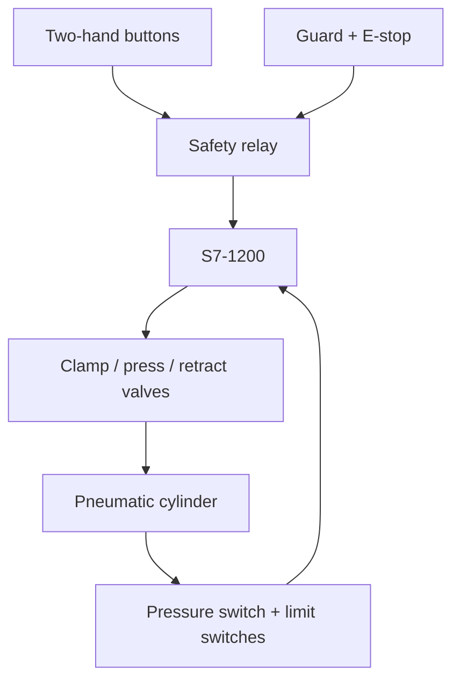

# Architecture

## 1. Control path

## 2. Sequence states

| State | Meaning |
| --- | --- |
| `IDLE` | Ready, valves de-energized |
| `ARMED` | Both buttons pressed within window |
| `CLAMPING` | Clamp cylinder extending |
| `PRESSING` | Press cylinder extending |
| `HOLDING` | Pressure held for dwell time |
| `RETRACTING` | Press and clamp returning |
| `FAULT` | Latched fault, requires reset |

## 3. Simulation equivalence

The Python `PressSimulator` mirrors the PLC sequence and exposes the same tag names through a REST API. No real pneumatic hardware is connected.

## 4. Nota (ES)

El simulador permite demostrar el comportamiento lógico; la parte de seguridad funcional debe validarse con hardware y normativa aplicable.
